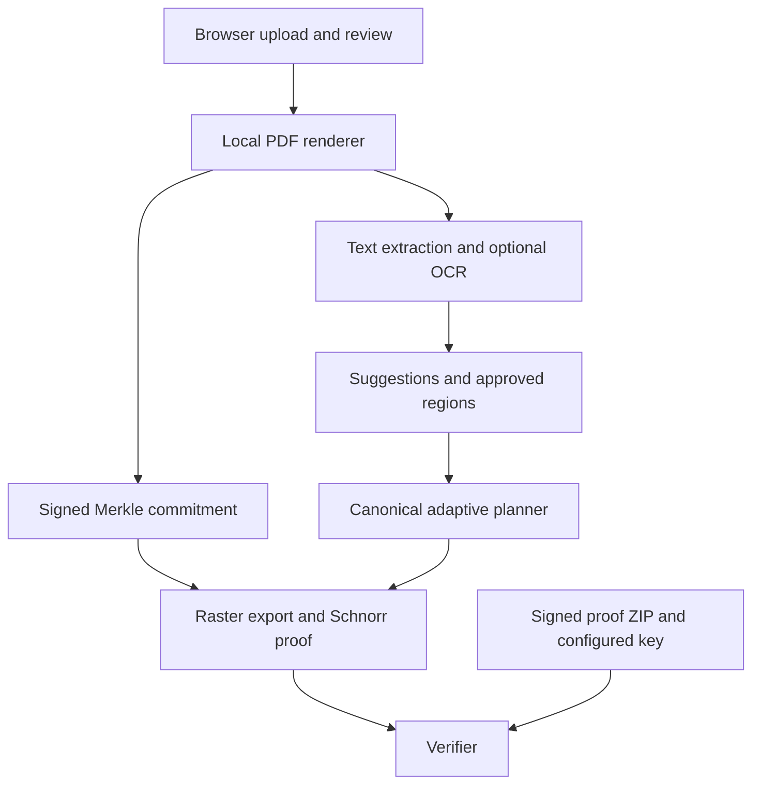

# LegitZK PDF Disclosure Studio | Architecture

| Component | Implementation |
|---|---|
| Browser | `pdf_web/` contains the preview, detection UI, manual controls, disclosures and offline-local verification form. |
| API | `pdf_studio.py` serves loopback FastAPI. The v2 endpoints support upload, detection, request planning, proof generation, signed ZIP export and bundle inspection. Common endpoints expose the page preview, public key, workspace close and verification. |
| Detection | `field_detector.py` extracts PyMuPDF text coordinates, optionally invokes local Tesseract, and returns regions and category labels. No recognized text is sent back by the detection API. |
| Planner | `adaptive_mask.py` validates and canonicalizes region policies, determines forced 8-pixel tiles, and merges uniform quadtree branches. |
| Proof | `adaptive_proof.py` signs and authenticates tile commitments, generates the export, and verifies the same plan. It reuses the Ristretto255 helper and the two-relation Schnorr protocol. |
| Compatibility | `pdf_redaction.py` contains shared PDF and proof operations and the old fixed-grid implementation. Verification dispatches using the signed receipt profile. `app.py` is the earlier threshold demo. |
| Benchmark | `benchmarks/adaptive_studio.py` analyzes independent synthetic layout families and compares adaptive, fixed-32 and fixed-8 modes on shared commitments and identical approved regions. |

## Trust boundary

The local ingester receives the original PDF and signs a receipt covering the PDF hash and the committed raster inventory. The two-file workflow trusts the configured issuer key and verifies the signed inventory and bundled request. Recipients who independently retain an expected request and receipt can use the earlier verification API. The verifier does not run the original PDF parser. It checks public consistency with the attested raster. The parser, classifier and OCR are trusted local code; no third-party service receives the original. The service is single-user and designed for loopback, with in-process PDF parsing and no server-side tenant isolation. The signing key persists in `.legitzk-pdf/ingestion.key`; workspaces are temporary and lazily pruned.
